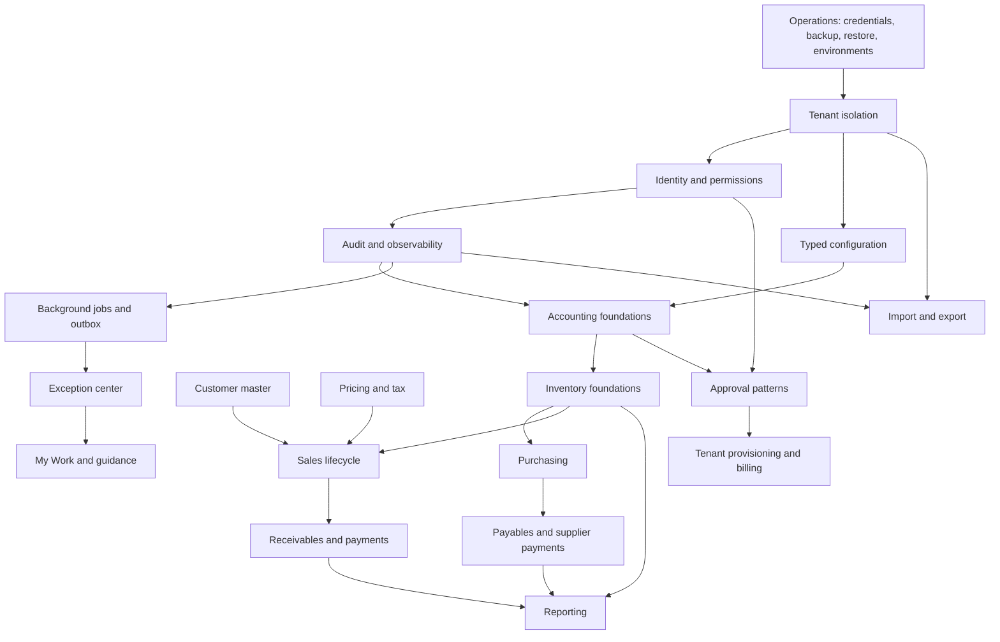

# خريطة الاعتماد / Dependency Map

## ترتيب الوحدات

| الوحدة | يجب أن يسبقها | مستقل جزئيًا | لا يبدأ بعد | القابل لإعادة الاستخدام | قرار مفتوح |
|---|---|---|---|---|---|
| Tenant Isolation (عزل الشركات) | هوية موثوقة | تدقيق bypass | RLS بلا دليل | النموذج الحالي | هل يلزم RLS؟ |
| Identity/Permissions (الهوية/الصلاحيات) | الشركة والعضوية | دعوات/تبديل | بوابة موحدة قبل ضبط النطاق | الأدوار الحالية | دعم المستخدم متعدد الشركات |
| Audit (التدقيق) | هوية/شركة | `P1-AUD-011` أساس منفذ ومغلق | ادعاء tamper-proof قبل checkpoint خارجي | AuditLog + AuditEvent + histories | `P1-AUD-012` تغطية ثم اعتماد قانوني للمدد |
| Configuration (الإعدادات) | شركة وتدقيق | جرد المفاتيح | محرك عام شامل | settings الحالية | تسلسل precedence |
| Accounting (المحاسبة) | تشغيل آمن وإعدادات | تقارير قراءة | ذمم قبل مستنداتها | القيد والفترة والحساب | توقيت COGS للمبيعات الجديدة محسوم في SAL-005 |
| Inventory (المخزون) | محاسبة/شركة | WMS مؤجل | cutover بلا مصالحة | الأرصدة والحركات والحجوزات | استلام النقل الجزئي |
| Purchases (المشتريات) | المورد/المخزون/المحاسبة | تحسينات تشغيلية | إعادة تصميم شاملة | المسار الحديث كامل | لا قرار حرج مفتوح |
| Customers (الزبائن) | الحساب/الصلاحيات | الملف الأساسي | BusinessPartner مباشر | Customer.Id | بوابة CUS-005 |
| Sales (المبيعات) | الزبون/التسعير/المخزون | العرض بعد الأساس | الفوترة قبل التسليم والسياسة | Sale/POS قديمان | مراحل SAL معتمدة |
| Approvals (الاعتمادات) | هوية/إعدادات | شراء حالي | تعميم قبل حالة ثانية | PurchaseApproval | استخراج محرك عام؟ |
| Provisioning/Billing (التجهيز/الفوترة) | شركة/خطط/تشغيل | sandbox دفع | مزود بلا ADR | SaaS control plane | المزود وwebhook |
| Jobs/Outbox (العوامل/صندوق الإرسال) | شركة/تدقيق | عوامل محددة | منصة عامة بلا حالة ثانية | supplier outbox | تقنية مستقبلية |
| Exceptions/Work (الاستثناءات/العمل) | مصادر موثوقة/صلاحيات | pilot قراءة | مصدر حقيقة جديد | المصالحة والتوجيه | أول استثناء |
| Import/Export (الاستيراد/التصدير) | عزل/تدقيق/قواعد مجال | تصميم مبكر | ترحيل محاسبي مباشر | مورد CSV/Excel | أول وحدة pilot |
| Reporting (التقارير) | مصادر مستقرة | شراء الآن | خلط posted/unposted | purchase analytics | مخزن تقارير لاحقًا فقط بقياس |
