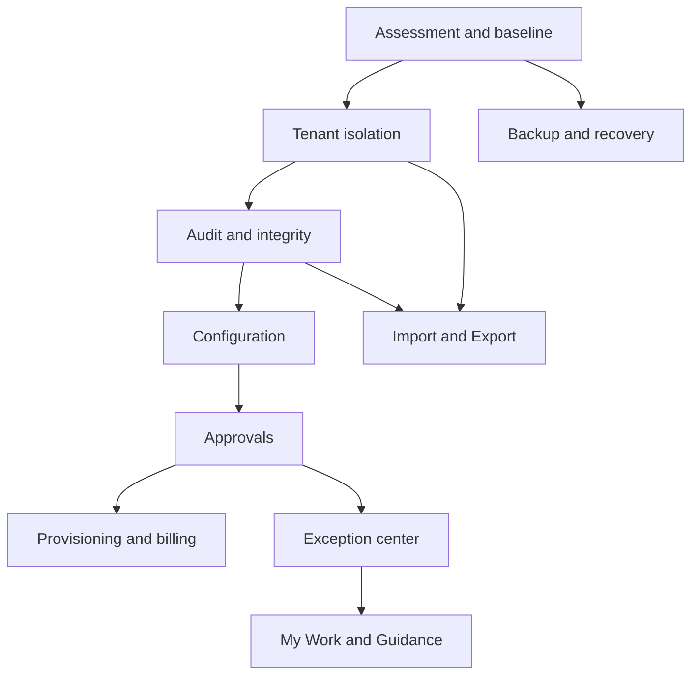

# Dependency graph
Foundation: discovery + backups/test baseline -> trusted tenant context and identity -> audit + integrity contracts -> configuration/versioning -> approvals -> provisioning/billing -> exceptions -> work/guidance -> import/export rollout.

Parallel lanes: DR design starts immediately; monitoring and restore drills accompany every migration. Import design can start early, but production imports must wait for tenant boundaries, validation and idempotent posting. Billing provisioning depends on tenant registry and configuration defaults. Guidance consumes authoritative workflow state; it must not define a second workflow engine.

Mermaid:

